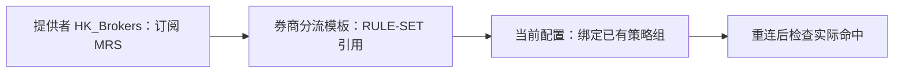

# Clash Mi：提供者订阅、分流模板与其他安装方式

## 选择安装方式

只需要订阅一个合并规则集，不用逐条输入域名。以下是备选方式，不要同时叠加。

| 方式 | 适合谁 | 自动更新 | 原机场规则处理 |
| --- | --- | --- | --- |
| [A. 分流模板 → 提供者订阅](#native-templates) | 已用 Clash Mi 完整模板管理分流的人 | MRS 域名集合，24 小时 | 保留既有完整模板和绑定；从机场规则切换到模板覆写会改变规则集合 |
| [B. 在现有配置追加提供者和引用](#configuration) | 能编辑配置或已有可靠追加机制的人 | 提供者自动拉取 | 只追加两处，保留原规则、节点、DNS、TUN |
| [C. JS 自动追加](#javascript) | 使用内置覆写，不方便编辑配置的人 | MRS 自动拉取 | 保留脚本接收到的原配置，新增一个通用选择组 |
| [D. 本地静态文件](#offline) | 离线环境或不想自动订阅的人 | 手动更新 | 在现有配置中使用，不替换完整机场配置 |

如果你直接使用机场下发规则、没有把整套原分流维护为模板，优先用 B 或 C。A 的原生模板流程也完整列在下面，但“覆写规则”不是无损追加开关，不能只启用券商一个模板就声称原规则仍在。

## 三种订阅格式

| 文件 | Format | Behavior | 使用位置 |
| --- | --- | --- | --- |
| [MRS](https://raw.githubusercontent.com/yindudegugezhanghao-lgtm/hk-brokers-rules/release/rules/HK_Brokers.mrs) | `mrs` | `domain` | Clash Mi 图形化规则提供者，推荐 |
| [YAML](https://raw.githubusercontent.com/yindudegugezhanghao-lgtm/hk-brokers-rules/release/rules/HK_Brokers.yaml) | `yaml` | `domain` | 支持此格式的配置文本 / 客户端 |
| [LIST](https://raw.githubusercontent.com/yindudegugezhanghao-lgtm/hk-brokers-rules/release/rules/HK_Brokers.list) | `text` | `classical` | 支持此格式的配置文本 / 客户端 |

三者是同一批域名的不同表示，选一种即可。在线订阅的 Type 均为 `http`，URL 使用 HTTPS，间隔可设 `86400` 秒。当前核对的 Clash Mi 图形界面只列出 MRS，不要假设能在该下拉框选择 YAML / text。

这些是**规则提供者订阅**，不能填进机场节点订阅入口。当前核对的规则模板是本地创建 / 编辑；本项目没有验证一条远程链接直接导入整套 Clash Mi 模板的能力，不能把 `.mrs` 当成完整模板或完整配置。

## 先保留现有配置

保留机场订阅及当前生效的覆写选择。安装前记录配置使用的是“内置-覆写”“内置-不覆写”还是自定义覆写；已有自定义脚本不要直接换掉。保持规则模式，不改 DNS、TUN、节点或现有通用分流。

仅添加“规则提供者”不会让流量自动命中它；实际配置还必须有 `RULE-SET,HK_Brokers,实际策略组名`。

<a id="native-templates"></a>

## A. 分流模板 → 提供者订阅



### 第一步：建立规则提供者

进入 **核心设置 → 分流模板 → 规则提供者 → ＋**，填写以下内容并保存：

| 字段 | 填写内容 |
| --- | --- |
| 名称 | `HK_Brokers` |
| Type | `http` |
| URL | `https://raw.githubusercontent.com/yindudegugezhanghao-lgtm/hk-brokers-rules/release/rules/HK_Brokers.mrs` |
| Format | `mrs` |
| Behavior | `domain` |
| 更新间隔 | 24 小时；要求秒数时填 `86400` |

这里只定义下载来源，还没有指定流量出口。

### 第二步：建立引用它的规则模板

返回 **分流模板 → 规则模板 → ＋**：

1. 模板名称填 `券商分流`，也可自行取名。
2. 模板内点 **＋**，新增一条规则，**Type** 选择 `RULE-SET`。
3. **规则提供者** 选择 `HK_Brokers`。
4. `NO-RESOLVE` 保持关闭，保存规则，再保存整个模板。

模板内保存的是两段引用：

```text
RULE-SET,HK_Brokers
```

**这个界面不填策略组**，目标由下一步当前配置的绑定补上。不要把全部域名逐条加进模板。

在模板列表中，把 `券商分流` 拖到通用 GEOIP / GEOSITE / MATCH 模板之前，保留其他模板及既有绑定。当前源码按模板列表顺序生成规则，同一模板内也按规则顺序匹配。不要只留下券商模板，或用一个 MATCH 代替原机场全部细分规则。

### 第三步：绑定当前配置的实际策略组

这一步适用于**原本已采用完整模板分流**，或已在设备上完整承接原分流的配置：

1. 先启动原机场配置并连接；当前源码要求在活动连接中编辑同一个配置，才能选择实际策略组。
2. 打开 **配置 → 当前机场配置 → 编辑 → 规则（rules）**。
3. 已使用模板覆写的人保留原有“覆写规则”启用状态。首次采用完整模板的人，须先满足下方原规则承接前提，再开启“覆写规则”。随后点 `券商分流`，选择自己现有的实际策略组；仅想追加券商一项的人不要在此直接开启开关。
4. 不需要重建代理组时，保持 **“覆写代理组”关闭**；选择原配置里的策略组，不用新建私人节点或固定地区。
5. 保存、重新加载或断开重连，在实际运行配置和连接详情中检查。

最终核心规则类似：

```text
RULE-SET,HK_Brokers,你选择的实际策略组名
```

模板名 `券商分流`、提供者名 `HK_Brokers`、实际策略组名承担不同作用，名字不必相同。可以选择自己现有香港、日本、美国或其他可用出口。

### 如果你还没有采用模板分流

在本次检查的源码中：

- “覆写规则”关闭时，模板绑定项不可点击，绑定也不会传入最终模板生成流程。只建提供者和模板不能据此认定已生效。
- 开启并绑定后，App 对规则、提供者和子规则设置替换标志；这不是保证保留原机场规则的追加路径。
- “内置-不覆写”路径不会返回上述自定义模板规则集合。不要仅为模板生效而随意改变内置模式，因为它也影响 DNS / TUN 等设置的处理。

因此，不建议普通机场原配置用户仅建一个券商模板后就开启“覆写规则”。要满足保留原规则的目标，需确认原分流已由完整模板及绑定承接；否则使用 B 或 C。这里完整说明原生功能，不把它误写成无条件保留任意机场配置的一键安装。

### 模板方式验收和停用

确认实际配置中同时存在：`HK_Brokers` 提供者、带实际目标组的三段 RULE-SET、原来需要的规则和提供者。再在券商连接详情中确认 `HK_Brokers` 命中及实际出口。下载成功只代表提供者可用。

停用时移除 / 取消绑定 `券商分流`，保留其他既有模板和绑定后重连；无其他模板引用时才删除项目提供者。如果曾从机场原规则切换到模板覆写，应恢复安装前的规则覆写状态和核心覆写选择。

<a id="configuration"></a>

## B. 现有配置追加提供者和一条引用

适用于能够编辑当前配置，或已经有保留原规则的追加机制的用户。

1. 在图形化“规则提供者”界面新增以下设置并保存。
2. 在当前配置或已有的安全追加机制中，将提供者加入 `rule-providers`，并在 `rules` 添加下面的一条引用。确认最终生效配置中两者都存在；不同版本中，图形界面的模板未必自动合并到当前配置。
3. 引用放在通用 GEOIP / GEOSITE / MATCH 前。若要覆盖机场原有同域规则，必须放在它们之前。保留原规则的顺序和内容。
4. 保存、重新加载配置或断开重连。检查连接详情中的匹配规则是否为 `RULE-SET / HK_Brokers`，并确认选中的是预期出口。

| 字段 | 值 |
| --- | --- |
| 名称 | `HK_Brokers` |
| Type | `http` |
| URL | `https://raw.githubusercontent.com/yindudegugezhanghao-lgtm/hk-brokers-rules/release/rules/HK_Brokers.mrs` |
| Format | `mrs` |
| Behavior | `domain` |
| 更新间隔 | 24 小时，若要求秒数则填 `86400` |

```yaml
rule-providers:
  HK_Brokers:
    type: http
    url: https://raw.githubusercontent.com/yindudegugezhanghao-lgtm/hk-brokers-rules/release/rules/HK_Brokers.mrs
    format: mrs
    behavior: domain
    path: ./rules/HK_Brokers.mrs
    interval: 86400

rules:
  - RULE-SET,HK_Brokers,PROXY_GROUP
  # 后面保留原有全部规则
```

这里的两个顶层段只用于展示应合并的内容；不要以此替换完整配置。`PROXY_GROUP` 必须替换为原配置中的真实策略组名，不能原样粘贴。不要固定写成某个节点名。

这一路径直接在配置文本中定义提供者，不依赖图形界面保存的本地模板提供者，也不需要开启“覆写规则”。如果修改的是机场订阅下载后的本地副本，下次刷新机场订阅可能覆盖修改；想长期保留要使用可靠追加机制或 C，不能把手改订阅缓存当成永久方案。

想用 YAML 时，将 URL 后缀改为 `.yaml`、`format` 改为 `yaml`，保持 `behavior: domain`；用 LIST 则改为 `.list`、`format: text`、`behavior: classical`。三种格式的 RULE-SET 引用相同。

**采用 B 的追加方式时，不要再为券商模板开启“覆写规则”。** 当前源码会为模板规则及提供者设置替换标志，可能覆盖你在原配置中保留的内容；完整原生模板管理的条件已单独写在 A 中。

<a id="javascript"></a>

## C. 可选 JS，自动追加

若原来只使用内置覆写、又不方便编辑配置，可使用这个通用脚本，免去手工添加提供者和 RULE-SET：

```text
https://raw.githubusercontent.com/yindudegugezhanghao-lgtm/hk-brokers-rules/main/examples/clash-mi.js
```

1. 打开“核心设置 → 覆写”，新增上面链接，类型选择 **JS**，名称可设为 `HK Broker Rules`。
2. 编辑该覆写的“追加-覆写”设置，保留安装前使用的内置模式：原来是“内置-覆写”就继续追加该模式，原来是“内置-不覆写”则继续相同模式。这样既有 App 核心设置仍按原方式处理；不要为本项目切换 DNS / TUN 设置。界面名称可能随版本变化，以当前版本为准。
3. 在当前机场配置的编辑页，将“核心覆写”选择为此脚本（仅应用到需要的配置）。保持原来的“覆写规则 / 覆写代理组”开关状态；如果这些开关已经启用并正在重建规则，应先把本项目追加逻辑整合到原机制，避免最终阶段把新增规则覆盖掉。
4. 保存并断开重连，在代理页面的 **`HK_Brokers_Policy`** 选择组中，选自己现有的策略组或节点。可以使用香港、日本、美国或其他可用出口。初次默认候选取自原配置顺序，并不代表推荐出口，请自行选择。
5. 在连接详情确认命中 `HK_Brokers`，并确认机场原有规则仍在。不要把能下载 MRS 当作已成功分流的证据。

脚本通过真实的 `main(config)` 接口接收配置，动态读取已有组、节点和 `proxy-providers`，只添加一个提供者、一个通用选择组和一条靠前规则，原规则顺序保持不变。原有 DNS、TUN、节点、原提供者及原组不被脚本重写。若已有同名选择组则保留并复用；若同名提供者指向不同资源或节点名称冲突，会明确报错。

脚本返回 JSON 字符串，Clash Mi 源码支持字符串作为最终 YAML 内容，JSON 也是有效 YAML。这避免 App 再序列化时丢失 DNS 通配符键引号。CI 检查通配符键、Unicode 组名、只有动态提供者的配置、重复应用及冲突处理，并用 Mihomo 校验生成配置。

MRS 提供者每 24 小时更新域名；JS 文件本身是否定时更新，由客户端的覆写更新设置决定。无需再额外创建 A 的模板，避免重复或后续替换。

**已有自定义 JS / YAML 覆写的用户：** 不要替换当前脚本。优先使用 B，或将本脚本函数改名后，在原 `main(config)` 的最终返回前调用，并按两者返回类型正确解析/串联。合并逻辑需要结合原脚本，项目不声称能无条件合并任意自定义覆写。

<a id="offline"></a>

## D. 本地静态文件，不自动订阅

可以将 MRS / YAML / LIST 下载到设备，在客户端支持的文件方式中使用。它们仍是规则集，不是完整节点配置。

- 支持文件提供者的配置可用 `type: file`，填写设备上实际可读的 `path`，Format / Behavior 按前面的格式表。当前核对的 Clash Mi 图形化提供者只支持 HTTP，本页不声称有文件提供者导入按钮。
- LIST 里的两段 DOMAIN-SUFFIX 行可整体合并进自己维护的 `rules`，但必须为每行补上实际策略组目标，保留原规则；不能把原始两段行直接当成完整核心规则。
- 本地静态文件不自动获得新增域名，更新时需手动下载 / 替换。停用先移除项目引用，再删除相关文件。

没有提供或验证：把 MRS 当节点订阅一键导入、把规则 YAML 当完整配置替换机场、用一条规则 URL 导入完整 Clash Mi 分流模板，以及未经验证的 YAML `+rules` 数组合并语法。无需把机场订阅交给公共第三方转换站。

## 常见问题

| 现象 | 检查 |
| --- | --- |
| 提供者下载成功但不分流 | 实际配置是否生成带目标组的 RULE-SET；是否是规则模式；前面是否已有命中规则 |
| 模板目标点不开 | “覆写规则”是否关闭；是否已连接当前正在编辑的配置。不要忽略 A 中原规则保留的前提 |
| 选择目标提示激活配置 | 先连接原配置，再编辑同一个配置的模板绑定 |
| 找不到 HK_Brokers | 提供者是否保存、名称是否一致，不要把模板名称当提供者名称 |
| 手改配置更新后消失 | 机场订阅刷新覆盖了本地副本，使用可靠追加机制 |
| 更新后短时仍旧版本 | GitHub raw CDN 可能缓存，稍后刷新；通常每 24 小时自动拉取 |

## 停用与恢复

- A：按模板小节取消项目绑定，保留其他模板；必要时恢复原覆写模式。
- B：先删除/停用新增的 `RULE-SET,HK_Brokers,...` 引用，再删除项目提供者；重新加载。其余原配置保持不变。
- C：把该机场配置的“核心覆写”切回安装前记录的选择，重新加载或断开重连；项目新增组、规则和提供者会随下一次配置生成消失。若采用了合并脚本，仅移除项目追加逻辑。不要删除原机场订阅。
- D：先移除引用，再移除项目静态文件。
- 若启动失败，先恢复原覆写并重连，再查看日志；提供者名错误、组名不存在、MRS 尚未下载、后续覆写又覆盖规则均可导致失败。需要更新规则时在提供者页刷新，通常每 24 小时自动拉取。

## 已核对的接口与实测边界

2026-10-16 再次核对 [KaringX/clashmi 官方源码提交 daef7be](https://github.com/KaringX/clashmi/tree/daef7be6c40d49a98a174a82c10599e163e71afd)。此前核对的公开发行版为 [v1.0.31.1703](https://github.com/KaringX/clashmi/releases/tag/v1.0.31.1703)，App Store 版本可能不同。

- [提供者类型、格式及行为](https://github.com/KaringX/clashmi/blob/daef7be6c40d49a98a174a82c10599e163e71afd/lib/app/modules/diversion_template_manager.dart)：`http`、`mrs`、`domain`；间隔内部以秒保存。
- [分流模板入口](https://github.com/KaringX/clashmi/blob/daef7be6c40d49a98a174a82c10599e163e71afd/lib/screens/group_helper.dart)、[RULE-SET 模板编辑](https://github.com/KaringX/clashmi/blob/daef7be6c40d49a98a174a82c10599e163e71afd/lib/screens/rule_templates_rule_add_or_edit_screen.dart)及[模板排序](https://github.com/KaringX/clashmi/blob/daef7be6c40d49a98a174a82c10599e163e71afd/lib/screens/rule_templates_screen.dart)：先保存两段引用，再由配置绑定补齐目标。
- [JS 执行入口及返回值处理](https://github.com/KaringX/clashmi/blob/daef7be6c40d49a98a174a82c10599e163e71afd/lib/app/modules/profile_patch_manager.dart)：执行 `main(config)`；字符串直接作为配置内容。
- [原规则替换行为](https://github.com/KaringX/clashmi/blob/daef7be6c40d49a98a174a82c10599e163e71afd/lib/app/modules/clash_setting_manager.dart) 与 [界面开关](https://github.com/KaringX/clashmi/blob/daef7be6c40d49a98a174a82c10599e163e71afd/lib/screens/profile_settings_edit_screen.dart)。
- [内置覆写追加顺序](https://github.com/KaringX/clashmi/blob/daef7be6c40d49a98a174a82c10599e163e71afd/lib/app/local_services/vpn_service.dart)。

已实现 GitHub Actions 上的真实 Mihomo MRS / HTTP 提供者与匹配验证。未在真实 iPhone 的 Clash Mi 界面或已登录券商 App 环境完成测试；界面路径和 App 自身最终合并行为需以实际版本生效配置确认。分流规则不能保证所有交易流量覆盖，也不决定券商的账户或地区政策。

